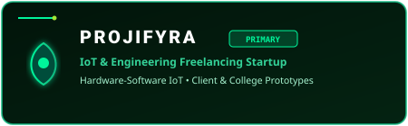
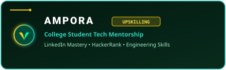
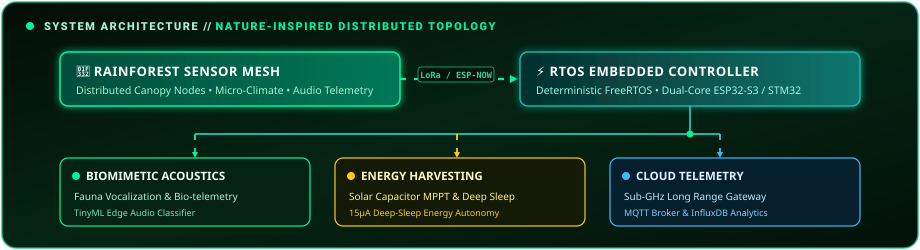

  

  <!-- Google SEO H1 Heading -->
  <h1>🌿 HARISH PRANAV S (@hyprpranav) 🌿</h1>

  <!-- ========================================== -->
  <!-- 01. ANIMATED HERO SECTION & JUNGLE CANOPY  -->
  <!-- ========================================== -->
  

    

  <!-- Dynamic Typing Subtitle in Emerald / Lime Theme -->
  

  

    <b>🌿 Architecting intelligent IoT hardware, low-power sensor telematics, and nature-inspired cyber-physical systems.</b>
     
    🎓 <b>Pre-Final Year B.E. (ECE)</b> at <b>M. Kumarasamy College of Engineering, Karur</b> • 📍 Hometown: <b>Bathalagundu, Dindigul, Tamil Nadu</b>
  

  <!-- Real-Time Mission Quick Telemetry -->
  

    
    
    
    
  

  <!-- Communication Transmission Channels -->
  

    
    
    
    
    
    
  

 

  

 

<!-- ========================================== -->
<!-- 02. INTERACTIVE 3-IN-1 JUNGLE ARCADE       -->
<!-- ========================================== -->

  

  

    🌿 <b>AMAZON JUNGLE ARCADE IS LIVE!</b> Step into the moonlit rainforest with 3 browser mini-games:
     
    🐍 <b>Amazon Anaconda (Snake)</b> • 🛶 <b>River Rapids Drift</b> • 🐆 <b>Canopy Wildlife Sprint</b>
     
    🌊 Features procedural Amazon River flow &amp; nocturnal crickets audio synthesized via the Web Audio API!
      
    
    
    
  

 

  

 

<!-- ========================================== -->
<!-- 03. PROFILE DASHBOARD & METRICS            -->
<!-- ========================================== -->

## 📊 BIOSPHERE TELEMETRY // GITHUB METRICS

  
Real-time engineering activity, language footprint, and continuous development velocity in emerald rainforest tones.

  <table border="0" cellpadding="0" cellspacing="0" width="100%">
    <tr>
      <td width="50%" align="center" valign="top">
        
      </td>
      <td width="50%" align="center" valign="top">
        
      </td>
    </tr>
    <tr>
      <td colspan="2" align="center" valign="top">
         
        
      </td>
    </tr>
  </table>

 

### 🐍 AMAZON ANACONDA COMMIT MATRIX // CONTINUOUS CODE CYCLE

  <picture>
    <source media="(prefers-color-scheme: dark)" srcset="assets/github-contribution-grid-snake.svg">
    <source media="(prefers-color-scheme: light)" srcset="assets/github-contribution-grid-snake.svg">
    
  </picture>
  

    🌿 Automated 24h cron synchronization via GitHub Actions <code>.github/workflows/snake.yml</code>
  

 

  

 

<!-- ========================================== -->
<!-- 04. STARTUP SHOWCASE & VENTURES            -->
<!-- ========================================== -->
## 🏢 VENTURE LABS // STARTUP SHOWCASE

  
Pioneering hardware-software IoT prototypes, student engineering mentorship, and technical upskilling.

| 

 | 

 |
| :--- | :--- |
| **⚡ PROJIFYRA (Primary Venture)** **Domain:** Project Development, IoT Integration &amp; Freelancing  <b>PROJIFYRA</b> is my flagship engineering initiative providing turnkey IoT prototypes, circuit designs, embedded firmware, and custom web dashboards for college capstone teams, community innovations, and freelance client engagements across both hardware and software domains.  • **Core Offerings:** Hardware + Software IoT Integrated Systems, PCB Design, Firmware • **Clientele:** Engineering Students, College Capstone Teams, Early-Stage Innovators • **Operational Status:** `ACTIVE // ACCEPTING CLIENT PROJECTS`  
 
 | **🌱 AMPORA (Secondary Initiative)** **Domain:** Student Technical Upskilling, LinkedIn Mastery &amp; Problem Solving  <b>AMPORA</b> was innovated as a peer-to-peer mentorship and skill development initiative within my college network. It equips engineering peers with structured guidance to build strong LinkedIn technical profiles, excel on HackerRank coding challenges, and develop core engineering project competencies.  • **Core Focus:** LinkedIn Personal Branding, HackerRank Problem Solving, Career Upskilling • **Target Audience:** Engineering Undergrads, Peer Students, Tech Enthusiasts • **Operational Status:** `STUDENT MENTORSHIP &amp; PEER NETWORK`  
 
 |

 

  

 

<!-- ========================================== -->
<!-- 05. TECHNICAL STACK & ARSENAL              -->
<!-- ========================================== -->
## 🛠️ TECH ARSENAL // MULTI-TIER SYSTEM STACK

  
Engineered with deterministic embedded firmware, robust sensor networks, and nature-inspired computing.

### 💻 01. PROGRAMMING & SYSTEM LANGUAGES

  
  
  
  
  
  
  
  

### ⚡ 02. EMBEDDED SYSTEMS & SILICON ARCHITECTURES

  
  
  
  
  
  
  

### 📡 03. IoT PROTOCOLS, BUSES & HARDWARE SCHEMATICS

  
  
  
  
  
  
  

### 🌐 04. WEB DEVELOPMENT & DISTRIBUTED TELEMETRY

  
  
  
  
  
  
  

### 🗄️ 05. DATABASES & CLOUD PLATFORMS

  
  
  
  
  
  

### 🔬 06. SIMULATION, CAD & ENGINEERING TOOLS

  
  
  
  
  
  
  

 

  

 

<!-- ========================================== -->
<!-- 06. FEATURED ENGINEERING PROJECTS          -->
<!-- ========================================== -->
## 🌿 FEATURED ENGINEERING PROJECTS // IoT ARCHITECTURES

  
Engineered hardware prototypes, community clean-tech modules, and embedded sensor networks.

| 🌲 **01. FloraSense (Canopy IoT)** | 🌍 **02. GroundGuard (Seismic IoT)** |
| :--- | :--- |
|    Deep forest canopy environmental sensing station. Logs forest humidity, soil moisture gradient, river stream turbidity, and acoustic wildlife bio-telemetry over ultra-low-power LoRa mesh nodes powered by energy-harvesting solar capacitors.  **Hardware &amp; Protocols:** ESP32-S3, LoRa SX1262, SHT31 Temp/Humidity, Solar Energy Harvester **Software &amp; Cloud:** MicroPython, MQTT, InfluxDB, Leaflet Eco-Map Visualizer 🔗 [`hyprpranav/florasense-canopy-iot`](https://github.com/hyprpranav/florasense-canopy-iot) |    Autonomous geotechnical &amp; seismic early-warning sensor station. Continuous multi-axis vibration analysis, soil liquefaction detection, and tilt telemetry capable of triggering acoustic alarms and broadcast alerts over emergency LoRaWAN mesh networks ahead of destructive S-waves.  **Hardware &amp; Protocols:** ESP32-S3, ADXL355 High-Res Accelerometer, LoRa SX1262, Solar MPPT **Software &amp; Cloud:** MicroPython, MQTT, Node-RED, GeoJSON Mapping API 🔗 [`hyprpranav/groundguard-early-warning`](https://github.com/hyprpranav/groundguard-early-warning) |
| 🛡️ **03. NeoGuard (Perimeter Security)** | 💡 **04. NeoLuma (Adaptive Lighting)** |
|    Smart perimeter surveillance and threat neutralization node. Integrates dual PIR and ultrasonic sensor fusion with edge vision to detect intrusions, log unauthorized breaches, and broadcast encrypted instant telegram/email telematics with snapshot verification.  **Hardware &amp; Protocols:** Raspberry Pi Zero 2W, ESP32-CAM, Ultrasonic Arrays, GSM/GPRS **Software &amp; Cloud:** OpenCV Edge Inference, C++, WebSockets, Telegram Bot API 🔗 [`hyprpranav/neoguard-security-system`](https://github.com/hyprpranav/neoguard-security-system) |    Intelligent municipal adaptive street-lighting grid. Dynamically modulates luminance based on vehicular traffic density, pedestrian presence, and ambient lux levels, delivering up to 42% energy reduction while alerting operators to burnt-out LEDs through remote mesh diagnostics.  **Hardware &amp; Protocols:** ATmega328P / ESP8266, LDR Lux Sensor, Microwave Doppler Radar, Triac Dimmers **Software &amp; Cloud:** Embedded C, MQTT Broker, React Admin Portal, Firebase 🔗 [`hyprpranav/neoluma-smart-lighting`](https://github.com/hyprpranav/neoluma-smart-lighting) |
| 🩺 **05. Beltiva (Biomedical Wearable)** | 🚗 **06. AutoSense (Vehicular Radar)** |
|    Ergonomic smart wearable assistive belt engineered for real-time lumbar posture tracking, geriatric fall impact detection, and respiratory rhythm monitoring. Features haptic biofeedback motors and an emergency SOS beacon linked via Bluetooth Low Energy (BLE) to mobile apps.  **Hardware &amp; Protocols:** Nordic nRF52840, MPU-6050 6-DOF IMU, Flexible Strain Sensor, Haptic Driver **Software &amp; Cloud:** Zephyr RTOS, BLE GATT Server, Flutter Companion App 🔗 [`hyprpranav/beltiva-smart-wearable`](https://github.com/hyprpranav/beltiva-smart-wearable) |    Intelligent vehicular blind-spot radar and collision avoidance auxiliary computer. Combines multi-directional millimeter-wave / ultrasonic proximity sensors with vehicle speed telemetry to project predictive collision cones and activate audible and HUD visual alerts for driver safety.  **Hardware &amp; Protocols:** STM32 Nucleo, 24GHz mmWave Radar, CAN Transceiver, OLED HUD **Software &amp; Cloud:** Embedded C++, FreeRTOS, OBD-II Protocol Interface 🔗 [`hyprpranav/autosense-vehicular-telematics`](https://github.com/hyprpranav/autosense-vehicular-telematics) |
| 🚆 **07. Smart Railway Safety System** | 🌱 **08. GOBARdhan (Biogas Automation)** |
|    Automated railway track crack detection, obstruction mitigation, and unmanned level-crossing safety module. Utilizes laser triangulation, IR arrays, and acoustic emission transducers on inspection trolleys with real-time GPS coordinate logging over GSM to prevent train derailments.  **Hardware &amp; Protocols:** Arduino Mega / ESP32, Laser Profiler, GPS NEO-6M, GSM SIM800L **Software &amp; Cloud:** Embedded C, SMS &amp; Cloud Webhook Telemetry, Leaflet GIS Dashboard 🔗 [`hyprpranav/smart-railway-safety-system`](https://github.com/hyprpranav/smart-railway-safety-system) |    IoT-automated bio-digester monitoring and bio-slurry quality assessment node supporting rural clean energy initiatives. Real-time logging of methane (CH4) concentrations, reactor pH, slurry temperature, and pressure containment with automated pressure release valve actuation.  **Hardware &amp; Protocols:** ESP32, MQ-4 Methane Sensor, Industrial pH Probe, DS18B20, Servo Actuator **Software &amp; Cloud:** C++, MQTT, ThingsBoard IoT Cloud, SMS Farmer Advisory 🔗 [`hyprpranav/gobardhan-biogas-iot`](https://github.com/hyprpranav/gobardhan-biogas-iot) |

 

  

 

<!-- ========================================== -->
<!-- 07. RESEARCH & NATURE-INSPIRED COMPUTING   -->
<!-- ========================================== -->
## 🔬 RESEARCH & NATURE-INSPIRED COMPUTING

  

 

| Research Thrust & Domain | Theoretical Scope, Embedded Topology & Outcomes |
| :--- | :--- |
| 🌿 **01. Biomimetic Sensing &amp; Eco-Acoustics**   | **Research Scope:** Real-time audio feature extraction and spectral filtering of Amazon wildlife vocalizations and river current turbulence to detect rare fauna presence and illegal deforestation activities in real time.  **Hardware &amp; Protocols:** Ultra-low-power MEMS microphones, ESP32-S3 Dual-Core (240MHz), Edge Impulse TinyML Neural Audio Classifiers, Sub-GHz LoRa gateway. |
| 🔋 **02. Autonomous Energy Harvesting**   | **Research Scope:** Continuous self-powering sensor stations utilizing ambient temperature gradients and canopy-filtered solar micro-cells paired with super-capacitors for zero-maintenance operation in dense forest understories.  **Hardware &amp; Protocols:** BQ25570 Nano-Power Harvester, 5.5V Supercapacitor Bank, Deep-Sleep Duty Cycling (15µA quiescent current draw). |
| 📡 **03. Resilient Forest Mesh Telemetry**   | **Research Scope:** Self-healing multi-hop telemetry across dense rainforest foliage without cellular infrastructure, relaying environmental data packets through tree-canopy repeater nodes back to basecamp dashboards.  **Hardware &amp; Protocols:** Semtech SX1262 LoRa Transceivers, ESP-NOW Peer-to-Peer Protocol, AES-128 Encrypted Packet Payloads, InfluxDB Analytics. |

 

  

 

<!-- ========================================== -->
<!-- 08. EDUCATION & ENGINEERING TIMELINE       -->
<!-- ========================================== -->
## 🎓 EDUCATION & ENGINEERING JOURNEY

  
Academic milestones, engineering leadership, venture founding, and hands-on technological innovations.

| Timeline & Role | Institutional & Entrepreneurial Engineering Milestones |
| :---: | :--- |
|  | 🎓 **Bachelor of Engineering (B.E.) – Pre-Final Year (3rd Year)** 🏛️ **M. Kumarasamy College of Engineering, Karur** 📘 **Specialization:** Electronics &amp; Communication Engineering (ECE) 🔬 **Core Curriculum:** Embedded Systems, Microcontroller Architectures, Signals &amp; Systems, VLSI Design, Sensor Networks |
|  | ⚡ **Founded PROJIFYRA – Primary Engineering Startup** 🚀 **Role:** Founder &amp; Chief IoT Architect 🛠️ **Milestone:** Delivering turnkey hardware-software embedded prototypes, custom PCB layouts, and full-stack IoT web dashboards; mentored over 50+ collegiate project teams. |
|  | 🌱 **Founded AMPORA – Technical Upskilling &amp; Mentorship** 💡 **Role:** Founder &amp; Engineering Coach 📈 **Milestone:** Spearheaded peer-to-peer technical development workshops, HackerRank algorithmic problem-solving bootcamps, and professional developer personal branding on LinkedIn. |
|  | 🔬 **Advanced Telematics &amp; Nature-Inspired IoT R&amp;D** 🌿 **Role:** Independent Embedded Systems Researcher 📡 **Milestone:** Designing edge AI sensor arrays, autonomous geotechnical seismic alert stations, and fault-tolerant transit telemetry modules. |

 

  

 

<!-- ========================================== -->
<!-- 09. HONORS, AWARDS & ACHIEVEMENTS          -->
<!-- ========================================== -->
## 🏆 HONORS, AWARDS & ACHIEVEMENTS

- 🎖️ **National / State Engineering Project Recognitions:** Honored for IoT innovations in railway safety systems, clean biogas automation (GOBARdhan), and smart municipal energy conservation.
- 📜 **Certified Embedded Systems Specialist:** Advanced hands-on proficiency in RTOS scheduling, firmware design, sensor fusion, and multi-protocol communication (CAN, LoRa, BLE, MQTT).
- 📜 **Multi-Layer PCB Design Proficiency:** Certified schematic capture and PCB layout using KiCad and Altium Designer.
- 💡 **Technical Hackathon Mentor & Speaker:** Guided student developer teams through hardware circuit debugging, microcontroller programming, and IoT cloud dashboard integration.

 

  

 

<!-- ========================================== -->
<!-- 10. DISPATCH TRANSMISSION // CONTACT       -->
<!-- ========================================== -->
## 📡 DISPATCH TRANSMISSION // GET IN TOUCH

Whether you are looking to commission an **IoT hardware-software prototype** through **PROJIFYRA**, collaborate on **embedded engineering R&amp;D**, or connect for student mentorship, I am always accessible across all channels.

  

    
    
    
    
  

   

  

    <code>📍 HOMETOWN: BATHALAGUNDU, DINDIGUL, TAMIL NADU, INDIA [UTC+05:30]</code>
     
    <code>🎓 INSTITUTION: M. KUMARASAMY COLLEGE OF ENGINEERING, KARUR (PRE-FINAL YEAR ECE)</code>
  

   

  

    
  
  
    Designed &amp; Engineered with precision by <b>Harish Pranav S</b> (<b>@hyprpranav</b>) // Powered by GitHub Flavored Markdown &amp; Nature-Inspired Engineering
  

