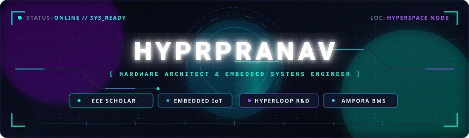
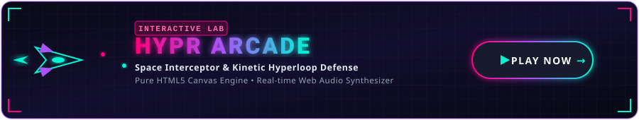
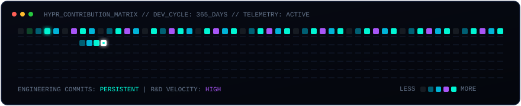
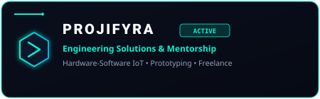
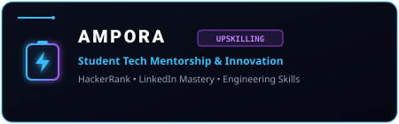

<div align="center" id="top">
  <a name="top"></a>

  <!-- ========================================== -->
  <!-- 01. ANIMATED HERO SECTION & BRAND IDENTITY -->
  <!-- ========================================== -->
  <a href="#-system-telemetry">
    
  </a>

  <br />

  <!-- Dynamic Animated Typing Subtitle -->
  <a href="https://github.com/hyprpranav">
    
  </a>

  <p align="center">
    <b>Architecting next-generation cyber-physical systems, intelligent IoT telematics, and high-velocity transit engineering.</b>
  </p>

  <!-- Real-Time Mission Quick Telemetry -->
  <p align="center">
    
    
    
    
  </p>

  <!-- Social Profile Transmission Channels -->
  <p align="center">
    <a href="https://github.com/hyprpranav">
      
    </a>
    <a href="https://linkedin.com/in/hyprpranav">
      
    </a>
    <a href="mailto:contact.hyprpranav@gmail.com">
      
    </a>
    <a href="https://x.com/hyprpranav">
      
    </a>
    <a href="https://hyprpranav.dev">
      
    </a>
  </p>

</div>

<br />

<div align="center">
  
</div>

<br />

<!-- ========================================== -->
<!-- 02. INTERACTIVE MINI-GAME: HYPR ARCADE     -->
<!-- ========================================== -->
<div align="center" id="-hypr-arcade">

  <a href="./hypr-arcade/index.html">
    
  </a>

  <p align="center">
    🚀 <b>HYPR ARCADE IS LIVE!</b> Test your reflexes in our lightweight retro-futuristic arcade shooter built with HTML5 Canvas &amp; Web Audio API.
    <br />
    <a href="./hypr-arcade/index.html">
      
    </a>
    <a href="./hypr-arcade/README.md">
      
    </a>
  </p>

</div>

<br />

<div align="center">
  
</div>

<br />

<!-- ========================================== -->
<!-- 03. PROFILE DASHBOARD & METRICS            -->
<!-- ========================================== -->
## 📊 SYSTEM TELEMETRY // GITHUB METRICS

<div align="center">
  <p>Real-time engineering activity, language footprint, and continuous development velocity.</p>

  <table border="0" cellpadding="0" cellspacing="0" width="100%">
    <tr>
      <td width="50%" align="center" valign="top">
        <a href="https://github.com/hyprpranav">
          
        </a>
      </td>
      <td width="50%" align="center" valign="top">
        <a href="https://github.com/hyprpranav">
          
        </a>
      </td>
    </tr>
    <tr>
      <td colspan="2" align="center" valign="top">
        <br />
        <a href="https://github.com/hyprpranav">
          
        </a>
      </td>
    </tr>
  </table>

</div>

<br />

### 🐍 CONTINUOUS COMMIT MATRIX // SNAKE RADAR

<div align="center">
  <!-- Dynamic Snake Generated via GitHub Actions with Pre-rendered High-Quality Fallback -->
  <picture>
    <source media="(prefers-color-scheme: dark)" srcset="assets/github-contribution-grid-snake.svg">
    <source media="(prefers-color-scheme: light)" srcset="assets/github-contribution-grid-snake.svg">
    
  </picture>
  <p align="center">
    <sub>⚡ Automated 24h cron synchronization via GitHub Actions <code>.github/workflows/snake.yml</code></sub>
  </p>
</div>

<br />

<div align="center">
  
</div>

<br />

<!-- ========================================== -->
<!-- 04. VENTURES & STARTUP SHOWCASE            -->
<!-- ========================================== -->
## 🏢 VENTURE LABS // STARTUP SHOWCASE

<div align="center">
  <p>Pioneering hardware solutions, intelligent battery infrastructure, and student engineering mentorship.</p>

  <table width="100%" border="0" cellpadding="8" cellspacing="0">
    <tr>
      <!-- PROJIFYRA CARD -->
      <td width="50%" valign="top">
        <div align="center">
          
        </div>
        <h3>⚡ PROJIFYRA</h3>
        <p><b>Domain:</b> Project Development, Technical Mentorship &amp; High-Impact Freelancing</p>
        <p>
          PROJIFYRA bridges academia and cutting-edge industrial R&amp;D. We empower engineering students, researchers, and early-stage innovators with turnkey hardware-software prototypes, rigorous code review, IoT architecture guidance, and specialized end-to-end project consulting.
        </p>
        <ul>
          <li><b>Core Focus:</b> Turnkey Embedded Prototypes, Circuit Design, Mentorship</li>
          <li><b>Target Audience:</b> Engineering Undergrads, Researchers, Tech Startups</li>
          <li><b>Status:</b> <code>OPERATIONAL // ACCEPTING CLIENTS</code></li>
        </ul>
        <div align="center">
          <a href="mailto:projifyra.official@gmail.com">
            
          </a>
          <a href="https://linkedin.com/company/projifyra">
            
          </a>
        </div>
      </td>

      <!-- AMPORA CARD -->
      <td width="50%" valign="top">
        <div align="center">
          
        </div>
        <h3>🔋 AMPORA</h3>
        <p><b>Domain:</b> EV Battery Management Systems (BMS) &amp; Energy Engineering</p>
        <p>
          AMPORA engineers intelligent, safety-critical battery intelligence platforms for electric mobility and micro-grids. Implementing deterministic active-balancing topology, real-time CAN/BLE telemetry, high-precision State of Charge (SoC), and predictive thermal runaway prevention.
        </p>
        <ul>
          <li><b>Core Focus:</b> Smart BMS Firmware, Active Balancing, EV Safety Telemetry</li>
          <li><b>Target Audience:</b> EV OEMs, Light Electric Mobility, Energy Storage Systems</li>
          <li><b>Status:</b> <code>RESEARCH &amp; HARDWARE PROTOTYPING</code></li>
        </ul>
        <div align="center">
          <a href="mailto:ampora.energy@gmail.com">
            
          </a>
          <a href="https://linkedin.com/company/ampora-energy">
            
          </a>
        </div>
      </td>
    </tr>
  </table>

</div>

<br />

<div align="center">
  
</div>

<br />

<!-- ========================================== -->
<!-- 05. TECHNICAL STACK & ARSENAL              -->
<!-- ========================================== -->
## 🛠️ TECH ARSENAL // MULTI-TIER SYSTEM STACK

<div align="center">
  <p>Engineered with low-level determinism, robust network protocols, and distributed cloud computing.</p>
</div>

### 💻 01. PROGRAMMING & SYSTEM LANGUAGES
<p align="center">
  
  
  
  
  
  
  
  
</p>

### ⚡ 02. EMBEDDED SYSTEMS & SILICON ARCHITECTURES
<p align="center">
  
  
  
  
  
  
  
</p>

### 📡 03. IoT PROTOCOLS, BUSES & HARDWARE SCHEMATICS
<p align="center">
  
  
  
  
  
  
  
</p>

### 🌐 04. WEB DEVELOPMENT & DISTRIBUTED TELEMETRY
<p align="center">
  
  
  
  
  
  
  
</p>

### 🗄️ 05. DATABASES & TIME-SERIES TELEMETRY
<p align="center">
  
  
  
  
  
  
</p>

### 🔬 06. SIMULATION, CAD & ENGINEERING TOOLS
<p align="center">
  
  
  
  
  
  
  
  
</p>

<br />

<div align="center">
  
</div>

<br />

<!-- ========================================== -->
<!-- 06. FEATURED ENGINEERING PROJECTS          -->
<!-- ========================================== -->
## 🚀 ENGINEERING SHOWCASE // SYSTEM PROJECTS

<div align="center">
  <p>Engineered hardware prototypes, safety-critical telemetry modules, and embedded IoT architectures.</p>
</div>

<table width="100%" border="0" cellpadding="8" cellspacing="0">

  <!-- ROW 1: AMPORA BMS & GROUNDGUARD -->
  <tr>
    <td width="50%" valign="top">
      <h3>⚡ 01. AMPORA Smart BMS</h3>
      <p>
        
        
      </p>
      <p>
        Next-generation high-safety Battery Management System designed for Light Electric Vehicles (LEVs) and modular energy storage. Features cell-level voltage monitoring (±2mV precision), active capacitive balancing, multi-zone thermal runaway detection, and CAN Bus telemetry streaming to cloud dashboards.
      </p>
      <p><b>Hardware &amp; Protocols:</b> STM32 / ESP32, BQ76952 AFE, CAN Bus, BLE, FreeRTOS</p>
      <p><b>Software &amp; Cloud:</b> Embedded C, Python Telemetry, InfluxDB, Grafana Dashboard</p>
      <p>
        🔗 <a href="https://github.com/hyprpranav/ampora-smart-bms"><code>hyprpranav/ampora-smart-bms</code></a>
      </p>
    </td>

    <td width="50%" valign="top">
      <h3>🌍 02. GroundGuard</h3>
      <p>
        
        
      </p>
      <p>
        Autonomous geotechnical &amp; seismic early-warning sensor station. Continuous multi-axis vibration analysis, soil liquefaction detection, and tilt telemetry capable of triggering acoustic alarms and broadcast alerts over emergency LoRaWAN mesh networks ahead of destructive S-waves.
      </p>
      <p><b>Hardware &amp; Protocols:</b> ESP32-S3, ADXL355 High-Res Accelerometer, LoRa SX1262, Solar MPPT</p>
      <p><b>Software &amp; Cloud:</b> MicroPython, MQTT, Node-RED, GeoJSON Mapping API</p>
      <p>
        🔗 <a href="https://github.com/hyprpranav/groundguard-early-warning"><code>hyprpranav/groundguard-early-warning</code></a>
      </p>
    </td>
  </tr>

  <!-- ROW 2: NEOGUARD & NEOLUMA -->
  <tr>
    <td width="50%" valign="top">
      <h3>🛡️ 03. NeoGuard</h3>
      <p>
        
        
      </p>
      <p>
        Smart perimeter surveillance and threat neutralization node. Integrates dual PIR and ultrasonic sensor fusion with edge vision to detect intrusions, log unauthorized breaches, and broadcast encrypted instant telegram/email telematics with snapshot verification.
      </p>
      <p><b>Hardware &amp; Protocols:</b> Raspberry Pi Zero 2W, ESP32-CAM, Ultrasonic Arrays, GSM/GPRS</p>
      <p><b>Software &amp; Cloud:</b> OpenCV Edge Inference, C++, WebSockets, Telegram Bot API</p>
      <p>
        🔗 <a href="https://github.com/hyprpranav/neoguard-security-system"><code>hyprpranav/neoguard-security-system</code></a>
      </p>
    </td>

    <td width="50%" valign="top">
      <h3>💡 04. NeoLuma</h3>
      <p>
        
        
      </p>
      <p>
        Intelligent municipal adaptive street-lighting grid. Dynamically modulates luminance based on vehicular traffic density, pedestrian presence, and ambient lux levels, delivering up to 42% energy reduction while alerting operators to burnt-out LEDs through remote mesh diagnostics.
      </p>
      <p><b>Hardware &amp; Protocols:</b> ATmega328P / ESP8266, LDR Lux Sensor, Microwave Doppler Radar, Triac Dimmers</p>
      <p><b>Software &amp; Cloud:</b> Embedded C, MQTT Broker, React Admin Portal, Firebase</p>
      <p>
        🔗 <a href="https://github.com/hyprpranav/neoluma-smart-lighting"><code>hyprpranav/neoluma-smart-lighting</code></a>
      </p>
    </td>
  </tr>

  <!-- ROW 3: BELTIVA & AUTOSENSE -->
  <tr>
    <td width="50%" valign="top">
      <h3>🩺 05. Beltiva</h3>
      <p>
        
        
      </p>
      <p>
        Ergonomic smart wearable assistive belt engineered for real-time lumbar posture tracking, geriatric fall impact detection, and respiratory rhythm monitoring. Features haptic biofeedback motors and an emergency SOS beacon linked via Bluetooth Low Energy (BLE) to mobile apps.
      </p>
      <p><b>Hardware &amp; Protocols:</b> Nordic nRF52840, MPU-6050 6-DOF IMU, Flexible Strain Sensor, Haptic Driver</p>
      <p><b>Software &amp; Cloud:</b> Zephyr RTOS, BLE GATT Server, Flutter Companion App</p>
      <p>
        🔗 <a href="https://github.com/hyprpranav/beltiva-smart-wearable"><code>hyprpranav/beltiva-smart-wearable</code></a>
      </p>
    </td>

    <td width="50%" valign="top">
      <h3>🚗 06. AutoSense</h3>
      <p>
        
        
      </p>
      <p>
        Intelligent vehicular blind-spot radar and collision avoidance auxiliary computer. Combines multi-directional millimeter-wave / ultrasonic proximity sensors with vehicle speed telemetry to project predictive collision cones and activate audible and HUD visual alerts for driver safety.
      </p>
      <p><b>Hardware &amp; Protocols:</b> STM32 Nucleo, 24GHz mmWave Radar, CAN Transceiver, OLED HUD</p>
      <p><b>Software &amp; Cloud:</b> Embedded C++, FreeRTOS, OBD-II Protocol Interface</p>
      <p>
        🔗 <a href="https://github.com/hyprpranav/autosense-vehicular-telematics"><code>hyprpranav/autosense-vehicular-telematics</code></a>
      </p>
    </td>
  </tr>

  <!-- ROW 4: SMART RAILWAY & GOBARDHAN -->
  <tr>
    <td width="50%" valign="top">
      <h3>🚆 07. Smart Railway Safety System</h3>
      <p>
        
        
      </p>
      <p>
        Automated railway track crack detection, obstruction mitigation, and unmanned level-crossing safety module. Utilizes laser triangulation, IR arrays, and acoustic emission transducers on inspection trolleys with real-time GPS coordinate logging over GSM to prevent train derailments.
      </p>
      <p><b>Hardware &amp; Protocols:</b> Arduino Mega / ESP32, Laser Profiler, GPS NEO-6M, GSM SIM800L</p>
      <p><b>Software &amp; Cloud:</b> Embedded C, SMS &amp; Cloud Webhook Telemetry, Leaflet GIS Dashboard</p>
      <p>
        🔗 <a href="https://github.com/hyprpranav/smart-railway-safety-system"><code>hyprpranav/smart-railway-safety-system</code></a>
      </p>
    </td>

    <td width="50%" valign="top">
      <h3>🌱 08. GOBARdhan</h3>
      <p>
        
        
      </p>
      <p>
        IoT-automated bio-digester monitoring and bio-slurry quality assessment node supporting rural clean energy initiatives. Real-time logging of methane (CH4) concentrations, reactor pH, slurry temperature, and pressure containment with automated pressure release valve actuation.
      </p>
      <p><b>Hardware &amp; Protocols:</b> ESP32, MQ-4 Methane Sensor, Industrial pH Probe, DS18B20, Servo Actuator</p>
      <p><b>Software &amp; Cloud:</b> C++, MQTT, ThingsBoard IoT Cloud, SMS Farmer Advisory</p>
      <p>
        🔗 <a href="https://github.com/hyprpranav/gobardhan-biogas-iot"><code>hyprpranav/gobardhan-biogas-iot</code></a>
      </p>
    </td>
  </tr>

</table>

<br />

<div align="center">
  
</div>

<br />

<!-- ========================================== -->
<!-- 07. RESEARCH & DEEP TECH INNOVATION        -->
<!-- ========================================== -->
## 🔬 RESEARCH & DEEP TECH INNOVATION

```ascii
[ POD TELEMETRY BUS ] ──( CAN-FD / SPI )──> [ RTOS FLIGHT CONTROLLER ]
                                                   │
  ┌────────────────────────────────────────────────┴────────────────────────────────┐
  ▼                                                 ▼                               ▼
[ ACTIVE LEVITATION & PROXIMITY ]     [ THERMAL RUNAWAY MITIGATION ]     [ LOW-LATENCY TELEMETRY ]
Hall-Effect & Eddy Current Sensing    Real-Time Electrochemical Modeling  Sub-GHz Long Range Link
```

### 🚅 1. Hyperloop High-Speed Pneumatic & Magnetic Levitation
- **Subsystem Focus:** Sub-millimeter laser distance triangulation, high-speed aerodynamic drag measurement, and eddy-current emergency braking protocols.
- **Embedded Architecture:** Deterministic FreeRTOS tasks operating under 1ms response latency to preserve magnetic levitation stability.

### 🔋 2. Advanced Electrochemical Energy Storage (EV BMS)
- **Subsystem Focus:** Kalman Filter implementation for State of Charge (SoC) and State of Health (SoH) cell prediction.
- **Safety Architecture:** Dual hardware-isolated overvoltage, undervoltage, and thermal runaway emergency cutoff switches complying with functional safety standards.

### 📡 3. Decentralized Industrial IoT & Edge Telemetry
- **Subsystem Focus:** Low-power wide-area mesh networks (LoRaWAN & ESP-NOW) resilient to harsh industrial RF interference and power outages.

<br />

<div align="center">
  
</div>

<br />

<!-- ========================================== -->
<!-- 08. EDUCATION & MILESTONES                 -->
<!-- ========================================== -->
## 🎓 EDUCATION & ENGINEERING TIMELINE

<div align="center">

```
┌───────────────────────────────────────────────────────────────────────────────────────────┐
│  YEAR             MILESTONE & INSTITUTIONAL FOCUS                                          │
├───────────────────────────────────────────────────────────────────────────────────────────┤
│  2023 - 2027      BACHELOR OF ENGINEERING (B.E.)                                          │
│  [Present]        Electronics & Communication Engineering (ECE)                           │
│                   Focus: Embedded Systems, Signal Processing, VLSI & Digital Circuits      │
│                                                                                           │
│  2024             FOUNDED PROJIFYRA                                                       │
│                   Mentored 50+ students in robotics, IoT, and embedded electronics        │
│                                                                                           │
│  2025             LAUNCHED AMPORA ENERGY LABS                                             │
│                   Active development of smart BMS architecture for light EVs              │
│                                                                                           │
│  2025 - Present   HYPERLOOP POD SUBSYSTEM DEVELOPMENT & R&D                               │
│                   Sensors, active telemetry, and high-speed transit instrumentation       │
└───────────────────────────────────────────────────────────────────────────────────────────┘
```

</div>

<br />

<div align="center">
  
</div>

<br />

<!-- ========================================== -->
<!-- 09. HONORS, CERTIFICATIONS & ACHIEVEMENTS  -->
<!-- ========================================== -->
## 🏆 CERTIFICATIONS & ACHIEVEMENTS

- 🎖️ **National / University Level Engineering Competitions:** Recognized for innovative IoT architectures in rail safety and smart energy management.
- 📜 **Embedded Firmware Specialization:** Microcontroller interfacing, RTOS scheduling, and sensor integration.
- 📜 **PCB Design & Fabrication:** Hands-on multi-layer circuit layout using KiCad and Altium Designer.
- 💡 **Technical Speaker & Project Mentor:** Led hardware hackathon workshops guiding student developers through circuit debugging and embedded programming.

<br />

<div align="center">
  
</div>

<br />

<!-- ========================================== -->
<!-- 10. DISPATCH TRANSMISSION // CONTACT       -->
<!-- ========================================== -->
## 📡 DISPATCH TRANSMISSION // GET IN TOUCH

Whether you are interested in collaborating on **Hyperloop propulsion**, **EV Battery Management Systems**, **Embedded IoT hardware**, or need guidance via **Projifyra**, my communication link is always open.

<div align="center">

  <table border="0" cellpadding="8" cellspacing="0">
    <tr>
      <td align="center">
        <a href="mailto:contact.hyprpranav@gmail.com">
          
        </a>
      </td>
      <td align="center">
        <a href="https://linkedin.com/in/hyprpranav">
          
        </a>
      </td>
      <td align="center">
        <a href="https://github.com/hyprpranav">
          
        </a>
      </td>
    </tr>
  </table>

  <br />

  <p>
    <code>GPG KEY ID: 0x48595052</code> • <code>LOCATION: CHENNAI, INDIA [UTC+05:30]</code>
  </p>

  <br />

  <a href="#top">
    
  </a>

  <br /><br />
  
  <sub>
    Designed &amp; Engineered with precision by <b>HYPRPRANAV</b> // Powered by GitHub Flavored Markdown &amp; HTML5
  </sub>

</div>
